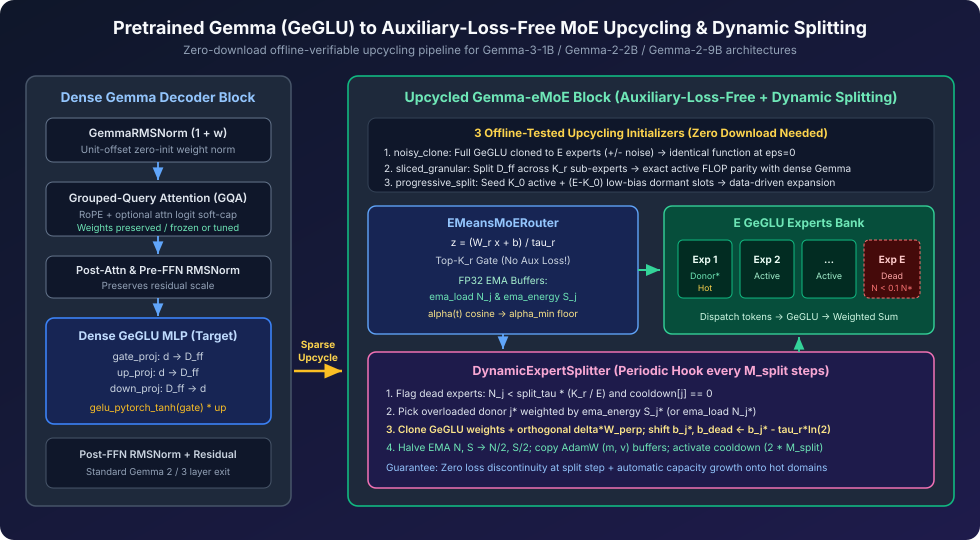

# MoE-Dynamic-Expert-Splitting

**Eliminating Routing Collapse in Sparse MoEs without Auxiliary Losses** — translating `e-means` sufficient statistics $(N_j, S_j)$, non-stationary cosine EMA floors ($\alpha_{\min}$), and function-preserving donor splitting ($b \leftarrow b - \tau_r \ln 2$) into **GeGLU Sparse MoE** architectures upcycled from **Gemma 2 / Gemma 3**.

> **Offline & Safe Setup**: Nothing in this repository automatically downloads Gemma checkpoints or launches full training runs. All exploratory profilers, mathematical proofs, and synthetic mini-runs execute locally out of the box.

---

## Repository Map

| Folder / File | Purpose |
| :--- | :--- |
| [**`docs/basic-terms/`**](./docs/basic-terms/00-INDEX.md) | Structured Markdown primers covering all base terms: `e-means` EMAs, Top-$K_r$ routing, routing collapse, $-\tau_r \ln(2)$ invariance, Gemma `GeGLU`/`RMSNorm`/`GQA`, scaling laws, and A–Z glossary |
| [**`docs/architecture/`**](./docs/architecture/IMPLEMENTATION-PLAN-GEMMA.md) | Full Gemma Dense-to-MoE upcycling blueprint, VRAM/FLOP breakdown, and Phase 0–3 execution plan |
| [**`docs/assets/images/`**](./docs/assets/images/) | Vector SVG architecture diagrams (`gemma-to-moe-upcycling.svg`, `split-invariance-geometry.svg`, `distributed-ep-dp-ema-sync.svg`) |
| **`src/moe_splitting/`** | Core modules: `config.py`, `router.py`, `experts.py`, `splitting.py`, `gemma_upcycle.py`, `metrics.py`, `scaling_law.py` |
| **`scripts/`** | Offline profiler (`explore_gemma_architecture.py`), NumPy verification mini-run (`mini_run_math_verify.py`), PyTorch TinyGemma upcycling dry-run (`mini_run_gemma_upcycle_torch.py`), and sweep planner (`plan_scaling_sweep.py`) |
| **`configs/`** | Ready JSON specs for `tiny-gemma-debug`, `gemma-3-1b`, and `gemma-2-2b` |
| **`tests/`** | Automated math & PyTorch verification tests |

---

## Visual Architecture: Gemma Upcycling & Dynamic Splitting



---

## Quick Start (Runs Immediately Without Downloads or Training)

```bash
# 1. Profile Gemma-3-1B / Gemma-2-2B / Gemma-2-9B Dense -> MoE shapes, VRAM & FLOPs
python scripts/explore_gemma_architecture.py

# 2. Prove -tau_r ln(2) softmax mass invariance + run 400-step multi-domain routing simulation
python scripts/mini_run_math_verify.py

# 3. Preview Phase-A scaling-law sweep matrix & verify OLS log-power-law fitter
python scripts/plan_scaling_sweep.py

# 4. Run offline mathematical unit tests
python -m unittest discover -s tests -p "*numpy*.py" -v
```

### Cluster / PyTorch Dry-Run (On a GPU Node with `torch` Installed)
```bash
# Upcycles offline TinyGemma -> asserts exact forward parity -> injects collapse -> splits -> 50 AdamW steps
python scripts/mini_run_gemma_upcycle_torch.py
pytest tests/
```
