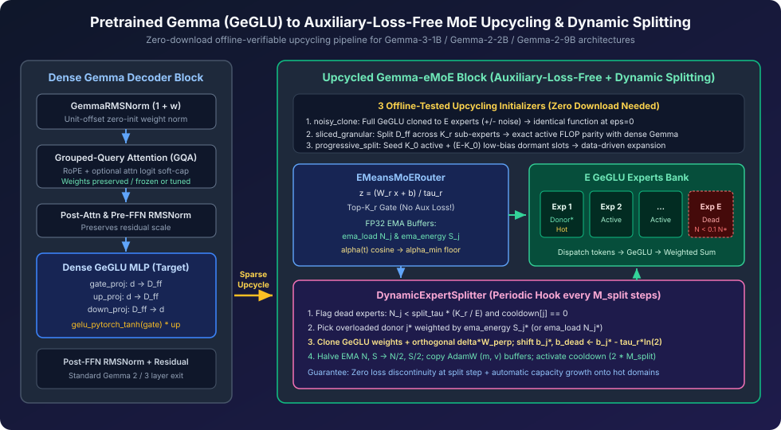
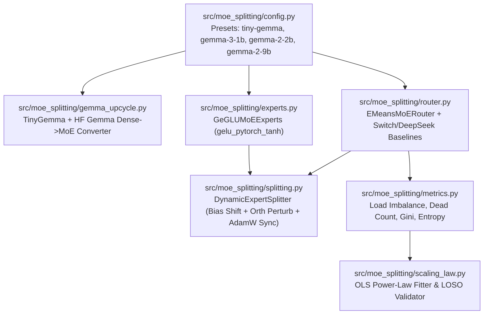
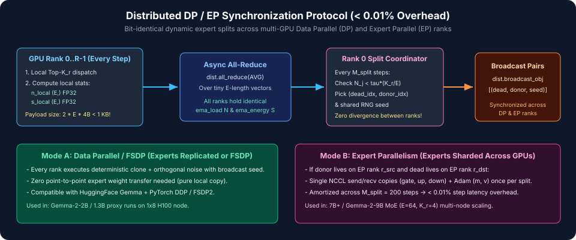

# Gemma Upcycling & Dynamic Expert Splitting Implementation Plan

> **Important Constraint Honored**: This repository is set up for **offline exploration, verification, and cluster-ready preparation**. No pretrained Gemma weights are downloaded and no full pretraining jobs are launched locally. All math, routing dynamics, upcycling shapes, and mini-runs can be inspected cleanly right now.

---

## 1. Visual System Architecture

---

## 2. Why Pretrained Gemma + `e-means` Dynamic Expert Splitting Works Cleanly

Upcycling a dense pretrained Transformer into a Sparse MoE (**Komatsuzaki et al., ICLR 2023**) avoids paying full scratch-pretraining cost while testing routing mechanics on real pretrained hidden manifolds:
1. **GeGLU 3-Matrix Compatiblity**: Both `Gemma 2` and `Gemma 3` use `GeGLU(x) = (gelu_pytorch_tanh(gate_proj(x)) * up_proj(x)) @ down_proj.T`, matching modern gated MoE expert blocks (`SwiGLU`/`GeGLU`) cleanly.
2. **Exact Step-0 Preservation**: Initializing all $E$ experts from Gemma's pretrained MLP weights (via `noisy_clone` or `sliced_granular`) ensures perplexity at step 0 matches or sits smoothly close to the pretrained dense baseline—while **`e-means` Dynamic Expert Splitting** removes the need for auxiliary loss gradients that would distort Gemma's delicate pretrained residual geometry!
3. **Progressive Specialization Testbed (`progressive_split`)**: By placing $K_0$ active clones and $(E - K_0)$ dormant slots (or inducing domain skew during continual training on code/math/prose), we directly measure how fast `DynamicExpertSplitter` carves dead slots from overloaded donor experts **with zero split-step loss spikes**.

---

## 3. Repository Architecture (`src/moe_splitting/` & `scripts/`)

---

## 4. Target Gemma Configurations Profiled (Zero-Download Estimates)

Run `python scripts/explore_gemma_architecture.py` to inspect exact per-layer tensor shapes, BF16 weights, AdamW optimizer states, and active FLOPs/token for:
1. **`tiny-gemma-debug`** ($d=128, D_{ff}=512, L=4$): Instant CPU/GPU unit-test & mini-run model.
2. **`gemma-3-1b`** ($d=1152, D_{ff}=6912, L=26$) upcycled to `E=16, K_r=2` (`noisy_clone` & `sliced_granular`).
3. **`gemma-2-2b`** ($d=2304, D_{ff}=9216, L=26$) upcycled to `E=16, K_r=2` & `E=32, K_r=2`.
4. **`gemma-2-9b`** ($d=3584, D_{ff}=14336, L=42$) upcycled to `E=64, K_r=4`.

---

## 5. Multi-Phase Research & Execution Workflow

### Phase 0: Local Exploratory & Mathematical Verification *(Runnable Now — Offline)*
1. `python scripts/explore_gemma_architecture.py` — Prints parameter counts, VRAM budgets, `sliced_granular` vs `noisy_clone` FLOPs, and `<1 KB` EMA sync overhead for all Gemma targets.
2. `python scripts/mini_run_math_verify.py` — Executes:
   - Machine-precision numerical check (`< 1e-13`) of the $-\tau_r \ln(2)$ softmax mass invariance theorem.
   - 400-step multi-domain non-stationary simulation comparing **No-Balance (Collapse)**, **Switch Aux-Loss**, **DeepSeek-V3 Bias**, and **`e-means` Dynamic Expert Splitting**.
3. `python -m unittest discover -s tests -p "*numpy*.py"` — Unit tests on all mathematical guarantees.

### Phase 1: Cluster Dry-Run on PyTorch `TinyGemma` *(Zero Download Needed)*
When running in an environment with PyTorch installed:
- `python scripts/mini_run_gemma_upcycle_torch.py` builds a random-weight `TinyGemmaForCausalLM`, runs a dense forward pass, converts it into `TinyGemmaMoE` via `upcycle_gemma_model(..., strategy="noisy_clone", init_noise_std=0.0)`, asserts **exact logit parity (`max diff < 1e-5`)**, injects skewed routing to trigger a dead expert, invokes `DynamicExpertSplitter`, checks split-step continuity, and runs 50 AdamW steps!

### Phase 2: Scaling-Law Proxy Sweeps on Gemma (`~160 H100 GPU-hours`)
- Use `python scripts/plan_scaling_sweep.py` to generate the exact `(BL, E, K_r, tau_r, alpha_min)` sweep grid.
- Continually pretrain small proxy MoEs on mixed **Code + Math + FineWeb-Edu** corpora (intentionally multi-domain to stress specialization vs. collapse).
- Fit $\alpha_{\min}^* = C_\alpha (BL)^{a_B} E^{a_E} K_r^{a_K} \tau_r^{a_\tau}$ via `src/moe_splitting/scaling_law.py`.

### Phase 3: Full Gemma-2-2B / 7B Upcycled Comparison (`~640–950 H100 GPU-hours`)
Compare matched-FLOP baselines over **30B–100B continual tokens**:
1. **Unbalanced Top-$K_r$** (collapse baseline)
2. **Switch / Mixtral Aux Loss** ($\lambda_{\text{aux}} = 0.01$)
3. **DeepSeek-V3 Dynamic Bias Balancing** ($\gamma_{\text{bias}} = 0.001$)
4. **Ours (`EMeansMoERouter` + `DynamicExpertSplitter`)**

Evaluate: Validation perplexity across domains, **zero split-step loss spike**, max-to-mean load ratio, dead-expert count, tokens/sec throughput, and downstream zero-shot benchmarks (`MMLU`, `GSM8K`, `HumanEval`, `ARC-C`, `HellaSwag`).

---

## 6. Distributed Architecture Diagram

