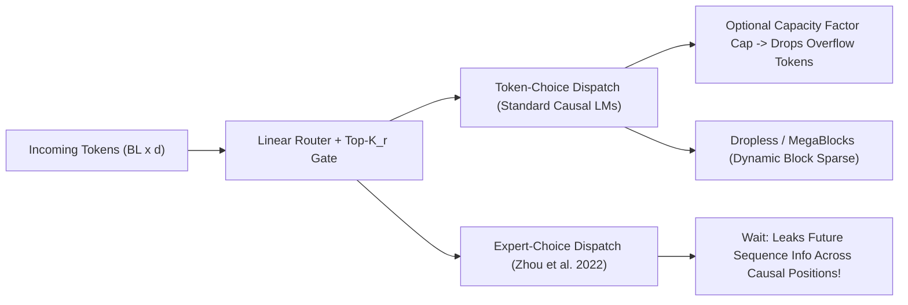

# 02. Sparse Mixture-of-Experts (MoE) Routing Fundamentals

> **Key Idea**: A Sparse MoE replaces a single dense Feed-Forward Network (FFN) with $E$ parallel "expert" FFNs, executing only $K_r \ll E$ experts per token so **model capacity scales with $E$ while FLOPs scale only with $K_r$**.

---

## 1. Anatomy of an MoE Layer

Given a batch of token hidden representations $X \in \mathbb{R}^{B \times L \times d}$ (flattened to $T = BL$ tokens $x_1, \dots, x_T \in \mathbb{R}^d$):

### A. Router (Gate) Logits
A linear gating layer with weight $W_r \in \mathbb{R}^{E \times d}$, optional bias $b \in \mathbb{R}^E$, and temperature $\tau_r > 0$ computes raw affinity scores for all $E$ experts:
$$
z_j(x) = \frac{(W_r x)_j + b_j}{\tau_r}, \qquad j \in \{1, \dots, E\}
$$

### B. Softmax Probabilities & Top-$K_r$ Selection
Converting logits to normalized gating probabilities across experts:
$$
p_j(x) = \frac{\exp(z_j(x))}{\sum_{m=1}^{E} \exp(z_m(x))}
$$
We select only the top-$K_r$ highest-scoring experts $\mathcal{T}(x) = \text{Top-}K_r(p(x))$ (common settings: $K_r = 2$ of $E=8$ or $16$, or $K_r = 4..8$ of $E=64$ fine-grained experts):
$$
g_j(x) = \begin{cases} \tilde{p}_j(x) & \text{if } j \in \mathcal{T}(x), \\ 0 & \text{otherwise.} \end{cases}
$$
*(Note: Some architectures like Mixtral/Qwen renormalize $\tilde{p}_j = p_j / \sum_{m \in \mathcal{T}(x)} p_m$ across only the Top-$K_r$ winners; others use unnormalized softmax weights directly—our bias-shift proof covers how both behave!)*

### C. Weighted Expert Output Aggregation
Each selected expert $f_j : \mathbb{R}^d \to \mathbb{R}^d$ runs on its routed tokens, and outputs combine linearly:
$$
\text{MoE}(x) = \sum_{j \in \mathcal{T}(x)} g_j(x) \, f_j(x)
$$

---

## 2. Routing Dispatch Paradigms

| Term | Exact Definition | Practical Trade-off |
| :--- | :--- | :--- |
| **Token-Choice Routing** | Each token picks its Top-$K_r$ experts independently. | Autoregressive-safe (causal); requires load balance to prevent stragglers. |
| **Expert-Choice Routing** | Each expert picks its Top-$C$ tokens from the sequence/batch. | Guarantees perfect load per expert, **but violates causal masking** across sequence tokens during LM training unless carefully restricted, and can leave hard tokens completely unselected! |
| **Capacity Factor ($CF$)** | Hard buffer limit $\text{cap} = \lceil CF \cdot \frac{K_r \cdot BL}{E} \rceil$ tokens/expert. | Drops tokens exceeding buffer cap (`CF=1.0–1.25`), discarding gradient signal unless balance holds. |
| **Dropless MoE (MegaBlocks)** | Formulates sparse routing as block-sparse matrix ops with zero token dropping. | Preserves accuracy, **but imbalanced experts explode activation memory & kernel latency**. |
| **All-to-All (`A2A`)** | Collective communication sending tokens to GPUs holding their target experts (Expert Parallelism, `EP`). | Latency equals the **slowest/most overloaded GPU** (**straggler problem**). |

---

## 3. Fair Share & Utilization Definitions

In an ideally balanced Top-$K_r$ router over $E$ experts, each token picks $K_r$ experts, so the sum of selection indicators across all experts is $K_r$:
$$
\sum_{j=1}^{E} \mathbb{I}(j \in \mathcal{T}(x)) = K_r \quad \implies \quad \text{Fair Share } \bar{N} = \frac{K_r}{E}
$$
For example, with $E = 16$ experts and $K_r = 2$, the fair selection probability per expert is $\bar{N} = 2 / 16 = 12.5\%$ of tokens per step.

---

## 4. Sources & Videos
- **Shazeer et al. (ICLR 2017)**: *Outrageously Large Neural Networks: The Sparsely-Gated Mixture-of-Experts Layer* ([arXiv:1701.06538](https://arxiv.org/abs/1701.06538))
- **Fedus et al. (JMLR 2022)**: *Switch Transformers: Scaling to Trillion Parameter Models* ([arXiv:2101.03961](https://arxiv.org/abs/2101.03961))
- **Gale et al. (MLSys 2023)**: *MegaBlocks: Efficient Sparse Training with Mixture-of-Experts* ([arXiv:2211.15841](https://arxiv.org/abs/2211.15841))
- **Video Search**: [Mixture of Experts (MoE) Routing & All-to-All Explained (YouTube)](https://www.youtube.com/results?search_query=Mixture+of+Experts+Transformer+routing+All-to-All+explained)
