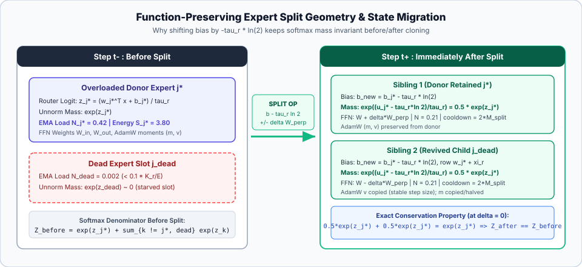

# 04. Function-Preserving Splitting & AdamW State Migration

> **Core Mathematical Contribution**: How to dynamically replace a dead expert slot $j_{\text{dead}}$ by cloning an overloaded donor $j^*$ so the network's forward predictions and training loss remain **invariant at the split step**. The $-\tau_r \ln 2$ bias shift alone does this for the dense softmax mixture only; under hard Top-$K_r$ routing it also needs **sibling routing** (section 3b). Measured: PoC 2 split $\Delta\mathcal{L} = 0$ on a fixed probe batch, against up to $0.047$ nats for the bias shift with plain Top-$K_r$ (tiny Gemma, 240 steps, CPU).

---

## 1. Visual Intuition

---

## 2. Why Naive Splitting Causes Catastrophic Loss Spikes

Suppose donor expert $j^*$ has pre-temperature router score $u_{j^*} = w_{j^*}^\top x + b_{j^*}$ and logit $z_{j^*} = u_{j^*} / \tau_r$.
If you naively copy $w_{j_{\text{dead}}} \leftarrow w_{j^*}$ and $b_{j_{\text{dead}}} \leftarrow b_{j^*}$ **without adjusting the biases**, then the softmax denominator gains an extra duplicate term $e^{z_{j^*}}$:
- The pair's **combined routing probability suddenly surges** from $\frac{e^{z_{j^*}}}{Z}$ to $\frac{2 e^{z_{j^*}}}{Z + e^{z_{j^*}}}$!
- Worse, in Top-$K_r$ ($K_r = 2$) routing, **both slots in Top-2 immediately become the two clones**, blocking the token's true 2nd expert $k_2$ and injecting huge downstream activation shocks! *(Note: even for $K_r=2$, let's check both Top-$K_r$ renormalization and probability mass!)*

---

## 3. Exact Proof of Softmax Mass Invariance (`b <- b - tau_r ln 2`)

Set the router bias of **both** children (`j^*` and `j_dead`) to:
$$
b_{j^*}^{\text{new}} = b_{j^*}^{\text{old}} - \tau_r \ln(2), \qquad b_{j_{\text{dead}}}^{\text{new}} = b_{j^*}^{\text{old}} - \tau_r \ln(2)
$$
(Equivalently, if the router uses linear bias *before* dividing by $\tau_r$, $(w^\top x + b) / \tau_r$, subtracting $\tau_r \ln 2$ shifts the post-temperature logit by exact $-\ln 2$. If the bias is added *after* dividing by $\tau_r$, subtract $\ln 2$ directly.)

Then for any input hidden state $x$ (with tiny symmetry-breaking $\xi_r = 0$):
$$
\exp\!\left(\frac{w_{j^*}^\top x + (b_{j^*} - \tau_r \ln 2)}{\tau_r}\right) = e^{z_{j^*}} \cdot e^{-\ln 2} = \frac{1}{2} e^{z_{j^*}}
$$
Therefore, summing over both sibling experts:
$$
\exp(z_{j^*}^{\text{new}}) + \exp(z_{j_{\text{dead}}}^{\text{new}}) = \frac{1}{2} e^{z_{j^*}} + \frac{1}{2} e^{z_{j^*}} = \boxed{e^{z_{j^*}}}
$$

### Two Immediate Consequences
1. **Unchanged Denominator & Other Experts**: The total softmax partition function $Z = \sum_{m=1}^{E} e^{z_m}$ stays invariant (ignoring negligible $e^{z_{\text{dead}}} \approx 0$ before split), so **all other $E-2$ experts keep their exact softmax weights**!
2. **Function Preservation Under Weighted Sum**: When both siblings compute identical FFN outputs $f_{\text{split}}(x) = f_{j^*}(x)$ and their raw softmax weights add up to $\frac{1}{2}p_{j^*} + \frac{1}{2}p_{j^*} = p_{j^*}$, total contribution is identical!
   - This argument is about the **dense** mixture $\sum_m p_m f_m(x)$. A Top-$K_r$ MoE does not compute that sum, and the argument does not carry over: see section 3b.

---

## 3b. Top-$K_r$ Routing: What the Bias Shift Does Not Preserve, and Sibling Routing

After the shift each sibling holds $p_{j^*}/2$. Hard Top-$K_r$ ranks experts individually, so for a token:
- if $p_{j^*}/2$ is still above the $K_r$-th competitor, **both siblings** enter the Top-$K_r$ and push out the token's previous $K_r$-th expert (at $K_r = 2$ the token then sees only one distinct FFN);
- if $p_{j^*}/2$ drops below it, **neither sibling** is selected and the token loses $f_{j^*}$ entirely;
- the renormalised weights change in both cases.

Neither a tie-breaking perturbation nor an offset gap repairs this; they only decide which of the two failures happens. PoC 1 measures it exactly (max output change 0.29 to 4.2 for plain Top-$K_r$, $K_r \in \{1, 2, 4\}$), and PoC 2 measures up to $0.047$ nats of loss per split event on the tiny Gemma ($0.018$ without the bias shift).

**Sibling routing** (`sibling_routing=True`, the default) restores exact invariance:
1. The split pair is one routing group with mass $P = p_{j^*} + p_{j_{\text{dead}}}$, which equals the donor's pre-split probability.
2. Top-$K_r$ runs over groups (an unsplit expert is its own group), so the selection of every other expert is unchanged.
3. Inside the group the token goes to the more probable sibling with weight $P$. The forward value is exactly the pre-split one; the gradient reaches the chosen sibling's logit through a straight-through term $w = p_{\text{chosen}} + (P - p_{\text{chosen}})_{\text{detached}}$.
4. At most one sibling of a pair is ever active for a token, so active compute is unchanged.

**Which sibling gets which tokens.** The router rows become $W_{j^*} \pm r$ and the biases $b - \tau_r \ln 2 \mp r^\top \mu$, where $\mu$ is the donor's EMA token centroid. The hyperplane through $\mu$ splits the donor's tokens roughly in half: a 2-means split in router space, which is where the e-means analogy actually applies. The pair mass becomes $p_{j^*} \cosh(r^\top(x-\mu)/\tau_r)$, an $O(\|r\|^2)$ change; $\|r\|$ is set from the EMA token spread so the typical $|r^\top(x-\mu)|/\tau_r \approx$ `router_noise_eps` (measured worst per-token change $4\times10^{-6}$ over $E \in \{6, 16\}$, $K_r \in 1..4$, $\tau_r \in \{0.5, 1, 2\}$).

### Leaving the merged state (un-merge) and what we measured
A pair is un-merged, i.e. returned to plain Top-$K_r$ routing, when:
- **separable**: the EMA of the measured routing disagreement (grouped vs plain Top-$K_r$ weights on the tokens the pair touches) stays below `unmerge_tol` after `unmerge_min_steps`. The jump is then bounded by that disagreement times the largest expert output; or
- **forced** at `merge_max_steps`: the routing is interpolated linearly from grouped to plain over `unmerge_ramp_steps`, one ramp per router at a time.

**Finding (tiny Gemma, CPU, PoC 2 Part A, 240 steps):** siblings did not become separable on their own. All 8 un-merges were forced (0 natural), after 99 to 114 steps merged.
- **The experts diverged; the routing did not.** At un-merge, the two FFNs of a pair had cosine 0.94 to 0.97 and a relative weight difference of 0.23 to 0.36 (`unmerge_pair_divergence` in the PoC 2 JSON). Only the chosen sibling is evaluated for a token, so the router never sees how the other sibling would have done on it. Nothing pushes the hyperplane to where the two experts' outputs differ.
- **A forced un-merge is not free.** The two ramp episodes (4 pairs each, 40 steps) cost +0.104 and −0.002 nats in total. A plain Top-$K_r$ split costs up to 0.047 per split event, so the cost is of the same order as the discontinuity sibling routing removes, and it is not predictable in sign. The ramp keeps every single step at or below 0.006, under the mean optimizer step (0.013). It spreads the change out; it does not remove it.
- **Merged experts cannot donate, so growth is throttled.** Both siblings of a pair are excluded as donors until the pair un-merges. Since every un-merge so far was forced at `merge_max_steps` (default 2000), the number of active experts can at most double per `merge_max_steps + unmerge_ramp_steps` cycle. PoC 4 (synthetic, 200 steps) shows it: 4 → 8 active experts per layer at step 60, then no further splits while 8 experts stayed dead.
- An earlier run reported 1.39 vs 1.48 nats. That run used an N(0, 1) embedding init that started the model near 26 nats, so those numbers are not meaningful. The init now matches HF (N(0, 0.02)).

Possible follow-ups, not implemented: a soft within-pair mixture (both siblings evaluated for tokens near the hyperplane, which gives the router the missing comparison signal), Lloyd-style sharpening of the hyperplane before un-merging, or never un-merging (the pair stays a two-leaf routing tree with one active slot).

---

## 4. Orthogonal Symmetry-Breaking Perturbation

If both child FFNs and router rows remained bit-identical ($\xi_r = 0, \delta W = 0$), deterministic backprop produces identical gradients forever—wasting one slot!
We add an **orthogonal perturbation** perpendicular to the existing weight vector direction so first-order norm magnitude is preserved:
1. Draw random Gaussian noise $u \sim \mathcal{N}(0, I)$.
2. Project out the donor weight direction:
   $$
   u_\perp = u - \frac{\langle u, W_{\text{donor}} \rangle}{\|W_{\text{donor}}\|_2^2 + \epsilon} W_{\text{donor}}, \qquad \hat{u}_\perp = \delta \cdot \|W_{\text{donor}}\|_2 \cdot \frac{u_\perp}{\|u_\perp\|_2 + \epsilon}
   $$
3. Symmetrically perturb both siblings:
   $$
   W_{j^*}^{\text{new}} = W_{\text{donor}} + \hat{u}_\perp, \qquad W_{j_{\text{dead}}}^{\text{new}} = W_{\text{donor}} - \hat{u}_\perp
   $$
   In the implementation this perturbation applies to the FFN weights only, with `orthogonal_eps = 0` by default: the copy stays exact and symmetry is broken by the router hyperplane (section 3b), because each sibling receives different tokens and therefore different gradients. The router rows use the centroid hyperplane offset $\pm r$ rather than a random orthogonal direction. How quickly siblings then specialise has not been shown: see the un-merge finding in section 3b.

---

## 5. Bookkeeping: EMA States, Cooldowns & AdamW Moments

Splitting weights alone is incomplete if optimizer buffers stay stale:

| Buffer / State | Action on `(donor j*, dead j_dead)` Split | Why Necessary |
| :--- | :--- | :--- |
| **`ema_load` ($N$)** | $N_{j^*} \leftarrow \frac{1}{2} N_{j^*},\;\; N_{j_{\text{dead}}} \leftarrow \frac{1}{2} N_{j^*}$ | Mirrors total expected traffic share across siblings so neither triggers instant re-split/re-donation. |
| **`ema_energy` ($S$)** | $S_{j^*} \leftarrow \frac{1}{2} S_{j^*},\;\; S_{j_{\text{dead}}} \leftarrow \frac{1}{2} S_{j^*}$ | Keeps routing energy calibrated. |
| **`ema_sum`, `ema_sqnorm`** (token centroid and spread) | Halved for the donor, copied to `j_dead` | Each sibling starts with half of the donor's traffic statistics; the centroid $\mu$ is unchanged. |
| **`partner`, `merge_age`, `ema_pair_disagree`, `unmerge_lambda`** | Pair recorded, counters reset | Drives sibling routing and the un-merge rules (section 3b). |
| **`cooldown` counter** | Both children set to `cooldown_steps` (e.g., $2 M_{\text{split}}$ steps) | Prevents freshly split experts from being flagged dead while AdamW diverges them onto sub-distributions. |
| **AdamW `exp_avg_sq` ($v$)** | **Copy directly** from donor to `j_dead` (for both FFN weights and router row) | Keeps per-parameter adaptive learning-rate preconditioner $1/\sqrt{v}$ continuous (no sudden LR spike on dead slot!). |
| **AdamW `exp_avg` ($m$)** | Copy $m$ (or halve $0.5 \cdot m$ on router row) for smooth momentum | Preserves warm momentum without directional shock. |

---

## 6. Sources & Videos
- **Net2Net**: Chen, Goodfellow, & Shlens (ICLR 2016), *Net2Net: Accelerating Learning via Knowledge Transfer* ([arXiv:1511.05641](https://arxiv.org/abs/1511.05641))
- **Function-Preserving Splitting of Neural Nets**: Liu et al. (ICML 2019), *Splitting Steepest Descent for Growing Neural Architectures* ([arXiv:1910.02366](https://arxiv.org/abs/1910.02366))
- **Video Search**: [Net2Net Function-Preserving Transformations Explained (YouTube)](https://www.youtube.com/results?search_query=Net2Net+function+preserving+neural+network+splitting)
