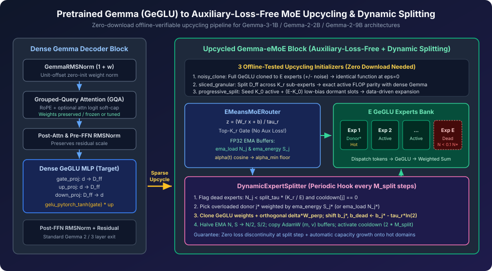

# 05. Pretrained Gemma Architecture & Sparse MoE Upcycling

> **Purpose**: Explains the exact architectural details of Google's **Gemma (`Gemma 2` & `Gemma 3`)** pretrained models and how **Sparse Upcycling** converts a pretrained dense Gemma checkpoint into an auxiliary-loss-free MoE ready for Dynamic Expert Splitting.

---

## 1. Visual Overview

---

## 2. Key Architectural Details of Gemma Models

When modifying or upcycling a pretrained **Gemma** (`google/gemma-3-1b-pt`, `google/gemma-2-2b`, `google/gemma-2-9b`), you must preserve these exact Gemma-specific design details:

### A. GeGLU Gated MLP (Target for Expert Conversion)
Unlike GPT-2's 2-layer MLP (`fc -> gelu -> proj`), Gemma uses a **3-matrix GeGLU FFN**:
$$
\text{GeGLU}(x) = \Big(\operatorname{GELU}_{\text{tanh}}(x W_{\text{gate}}^\top) \odot (x W_{\text{up}}^\top)\Big) W_{\text{down}}^\top
$$
- Parameter names in HuggingFace `Gemma2MLP` / `Gemma3MLP`:
  - `gate_proj`: `(intermediate_size, hidden_size)`
  - `up_proj`: `(intermediate_size, hidden_size)`
  - `down_proj`: `(hidden_size, intermediate_size)`
- Activation: `gelu_pytorch_tanh` ($\frac{1}{2} x (1 + \tanh(\sqrt{2/\pi}(x + 0.044715 x^3)))$).

### B. Gemma Unit-Offset `RMSNorm` (`1.0 + weight`)
Crucial quirk: HuggingFace / Google's `GemmaRMSNorm` initializes `weight = zeros(d)` and computes:
$$
\text{GemmaRMSNorm}(x) = \frac{x}{\sqrt{\frac{1}{d}\sum x_i^2 + \epsilon}} \odot (1.0 + w)
$$
*(If you accidentally replace this with a standard Llama `RMSNorm(x) * w` initialized to zeros, all activations vanish to zero!)*
Furthermore, Gemma 2 & Gemma 3 use **pre- and post-normalization** around both Attention and MLP (`pre_feedforward_layernorm` + `post_feedforward_layernorm`). Keeping these norms untouched ensures smooth continual training after MoE upcycling.

### C. Grouped-Query Attention (GQA), Logit Soft-Capping & Weight Tying
- **GQA**: Fewer KV heads (`num_key_value_heads < num_attention_heads`, e.g., 4 KV vs 8 Query in Gemma-2-2B) — stays frozen or jointly fine-tuned; MoE only alters the **MLP** block.
- **Logit Soft-Capping (Gemma 2)**: Applies $\text{cap} \cdot \tanh(x / \text{cap})$ (e.g., `50.0` on attention, `30.0` on final logits).
- **Tied Embeddings**: `lm_head.weight` shares storage with `embed_tokens.weight`.

---

## 3. Sparse Upcycling: Converting Dense Gemma to `e-means` MoE

Introduced by **Komatsuzaki et al. (ICLR 2023)** (*"Sparse Upcycling: Training Mixture-of-Experts from Dense Checkpoints"*), Sparse Upcycling reuses 100% of pretrained dense parameters to avoid paying full pretraining cost from scratch.

We support **three exploratory Gemma upcycling configurations** in `src/moe_splitting/gemma_upcycle.py`:

| Strategy | How Experts Are Seeded from Dense Gemma MLP | When to Use |
| :--- | :--- | :--- |
| **`noisy_clone`** *(Standard Upcycling)* | Clone all 3 GeGLU matrices into $E$ experts ($W^{(j)} \leftarrow W_{\text{dense}} + \sigma_{\text{init}} u_\perp$) with Top-$K_r$ weights normalized to sum to 1 (or scaled by $1/K_r$). At $\sigma_{\text{init}} = 0$, MoE output **matches dense Gemma identically**! | Best when matching dense Gemma initial perplexity at step 0, then letting domains diverge & split dead slots. |
| **`sliced_granular`** *(DeepSeek/Qwen-style Flop-Matched)* | Slice `intermediate_size` ($D_{ff}$) into finer sub-experts of width $D_{ff} / K_r$ (e.g., Gemma-2-2B `9216 -> 4608` per expert with $K_r = 2$) so **active FLOPs per token exactly equal dense Gemma**! | Ideal when strict inference/training FLOP parity with dense Gemma is required. |
| **`progressive_split`** *(Pure Dynamic Splitting Testbed)* | Activate only $K_0 < E$ cloned experts initially (e.g., $2$ high-bias active experts + $6$ initially dormant experts with strongly negative router bias $-5.0$) and watch **`DynamicExpertSplitter`** progressively carve the $E$ experts via data-driven demand! | Controlled testbed proving dynamic capacity allocation on pretrained Gemma representations! |

---

## 4. Reference Parameter Sizes (`Gemma` Family Specs in `config.py`)

| Model Preset | `hidden_size` ($d$) | Dense `intermediate_size` | Layers | Dense Params | Upcycled `E=16, K_r=2` Total / Active |
| :--- | :---: | :---: | :---: | :---: | :---: |
| **`tiny-gemma-debug`** *(Offline test)* | 128 | 512 | 4 | ~1.5M | ~7.4M total / ~2.3M active |
| **`gemma-3-1b`** *(Gemma 3)* | 1,152 | 6,912 | 26 | ~1.0B | ~9.3B total / ~1.6B active |
| **`gemma-2-2b`** *(Gemma 2)* | 2,304 | 9,216 | 26 | ~2.6B | ~26.7B total / ~4.2B active |

*(Run `python scripts/explore_gemma_architecture.py` to compute exact layer-by-layer shapes, VRAM, FLOPs, and `sliced_granular` vs `noisy_clone` counts offline!)*

---

## 5. Sources & Videos
- **Sparse Upcycling**: Komatsuzaki et al. (ICLR 2023), *Sparse Upcycling: Training Mixture-of-Experts from Dense Checkpoints* ([arXiv:2212.05055](https://arxiv.org/abs/2212.05055))
- **Gemma 2 Technical Report**: Gemma Team, Google DeepMind (2024) ([arXiv:2408.00118](https://arxiv.org/abs/2408.00118))
- **Gemma 3 Technical Report**: Gemma Team, Google DeepMind (2025) ([arXiv:2503.19786](https://arxiv.org/abs/2503.19786))
- **Video Search**: [Sparse Upcycling & GeGLU Transformers Explained (YouTube)](https://www.youtube.com/results?search_query=Sparse+Upcycling+Mixture+of+Experts+Gemma+GeGLU)
